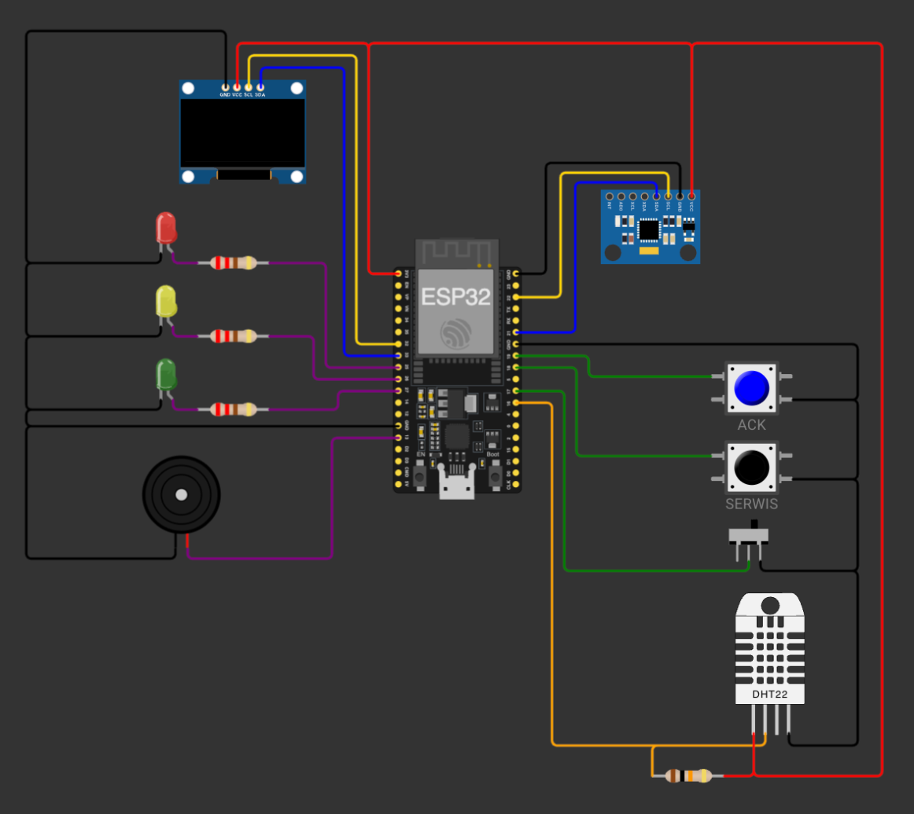
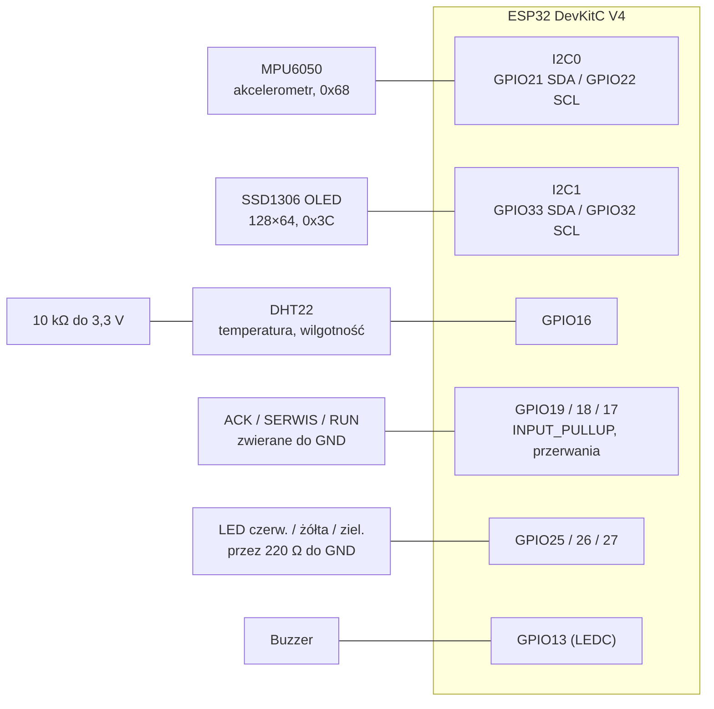
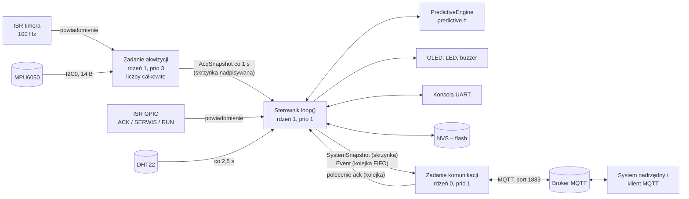
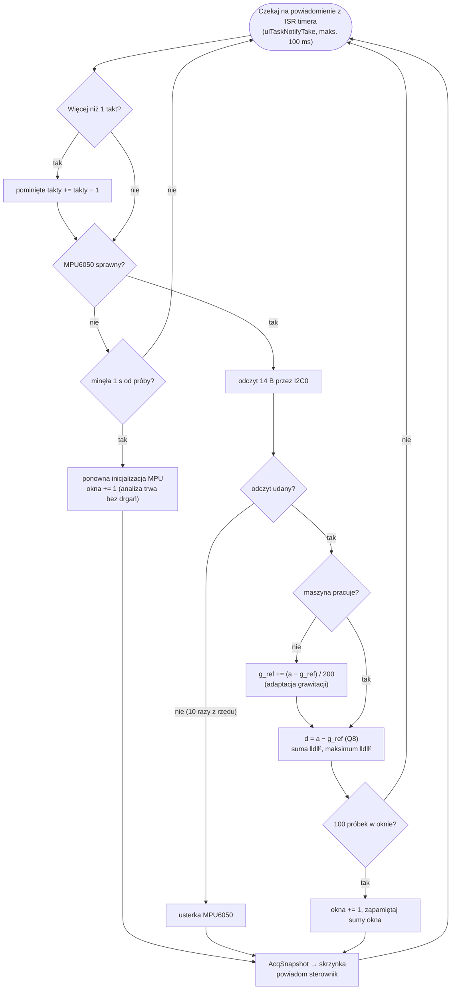
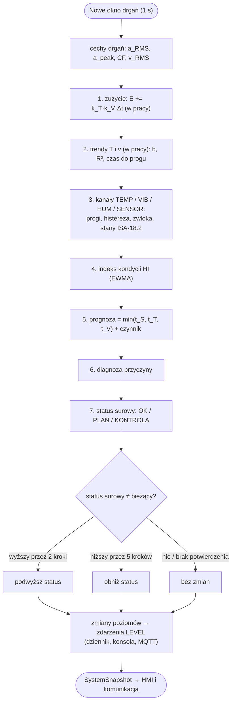
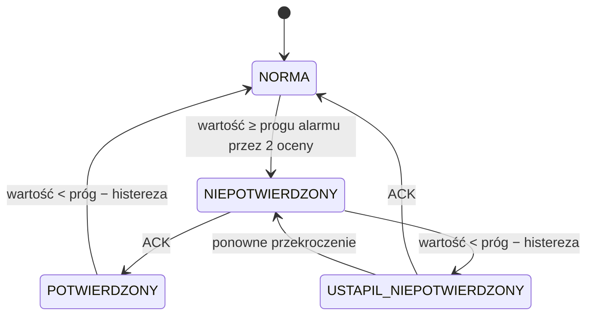
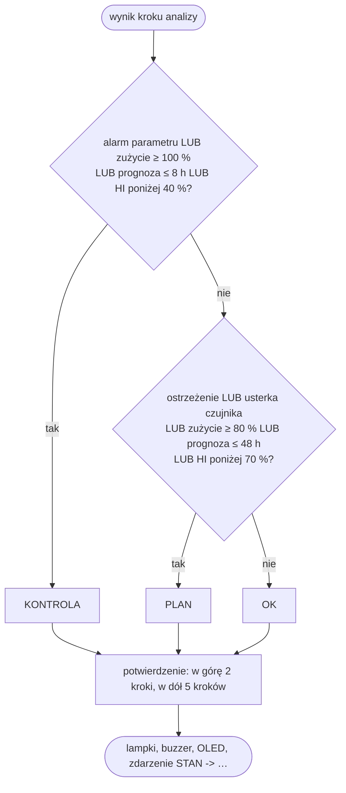

# Dokumentacja techniczna – Inteligentny system utrzymania ruchu maszyn

| | |
|---|---|
| **Przedmiot** | Wyzwania Technologiczne Przemysłu 4.0 – projekt zaliczeniowy |
| **Oprogramowanie** | WTP4-PdM 0.4.0 (`main.cpp`, `predictive.h`) |
| **Platforma** | ESP32 DevKitC V4 w symulatorze Wokwi, arduino-esp32 3.3.7, FreeRTOS |
| **Stan na dzień** | 14.10.2026 |

Dokumenty powiązane: [README.md](README.md) – uruchomienie i obsługa krok po kroku,
[TESTY.md](TESTY.md) – 8 scenariuszy testowych z wynikami, [PREZENTACJA.md](PREZENTACJA.md) –
scenariusz 10-minutowej prezentacji.

## Spis treści
1. [Cel i założenia](#1-cel-i-założenia)
2. [Architektura sprzętowa i schemat połączeń](#2-architektura-sprzętowa-i-schemat-połączeń)
3. [Architektura oprogramowania](#3-architektura-oprogramowania)
4. [Opis techniczny modułów](#4-opis-techniczny-modułów)
5. [Diagramy algorytmów](#5-diagramy-algorytmów)
6. [Optymalizacja i gospodarka pamięcią](#6-optymalizacja-i-gospodarka-pamięcią)
7. [Testy i wyniki](#7-testy-i-wyniki)
8. [Wyzwania technologiczne](#8-wyzwania-technologiczne)
9. [Dalszy rozwój](#9-dalszy-rozwój)
10. [Źródła](#10-źródła)

---

## 1. Cel i założenia

### 1.1 Problem

Utrzymanie ruchu maszyn odbywa się zwykle na jeden z trzech sposobów:

| Strategia | Kiedy serwis | Wada |
|---|---|---|
| reaktywna | po awarii | nieplanowany przestój, uszkodzenia wtórne |
| prewencyjna | co stały okres | serwis za wcześnie (koszt) albo za późno (awaria) |
| **predykcyjna** (Przemysł 4.0) | wtedy, gdy wskazuje na to **stan maszyny** | wymaga pomiarów i analizy danych |

Celem projektu jest system IoT realizujący strategię predykcyjną: mierzy kilka parametrów pracy maszyny,
łączy je w ocenę stanu i **prognozuje, za ile godzin pracy maszyna powinna zostać poddana kontroli**,
informując o tym lokalnie (kolumna sygnalizacyjna, wyświetlacz, sygnał dźwiękowy) i zdalnie (MQTT).

### 1.2 Realizacja wymagań

| Ocena | Wymaganie z wytycznych | Realizacja w projekcie |
|---|---|---|
| 3.0 | monitorowanie jednego parametru | drgania – akcelerometr MPU6050 próbkowany 100 Hz |
| 3.5 | co najmniej dwa parametry | + temperatura i wilgotność (DHT22), czas pracy i liczba uruchomień (sygnał RUN) |
| 4.0 | progi alarmowe | ostrzeżenie i alarm dla temperatury, drgań i wilgotności; histereza, zwłoka, kwitowanie wg ISA-18.2; sygnalizacja świetlna i dźwiękowa |
| 4.5 | historia pomiarów i zdarzeń | historia co 5 s (10 min), dziennik 32 zdarzeń, zdarzenia publikowane przez MQTT, liczniki w pamięci nieulotnej |
| 5.0 | analiza kilku parametrów jednocześnie i wskazanie, kiedy wykonać kontrolę | model zużycia zależny od temperatury i drgań, trendy z czasem do progu, indeks kondycji, diagnoza przyczyny z korelacji parametrów, prognoza „kontrola za X h” i status OK / PLAN / KONTROLA |

Wymagania jakościowe na 5.0: przerwania sprzętowe (timer, GPIO), wielozadaniowość FreeRTOS na dwóch
rdzeniach, brak `delay()` i alokacji pamięci w pętli pracy, komentarze Doxygen, testy jednostkowe,
osiem scenariuszy testowych.

### 1.3 Założenia

- **Maszyna:** pompa odśrodkowa z silnikiem 2-biegunowym (~2950 obr/min, składowa 1× obroty
  f = 49,2 Hz), klasa II wg ISO 10816-1 (15–75 kW).
- **Punkty pomiarowe:** akcelerometr na obudowie łożyska, temperatura obudowy, wilgotność otoczenia.
  DHT22 zastępuje w symulacji czujnik przemysłowy (np. Pt100) – logika jest od tego niezależna.
- **Czas przyspieszony:** 1 s symulacji = 1 h pracy maszyny (`cfg::kTimeScale = 3600`), żeby cykl
  zużycia był widoczny w minutach. We wdrożeniu wystarczy `kTimeScale = 1`.
- **Interwał przeglądu** w warunkach nominalnych: 200 h pracy.
- **Środowisko:** symulator Wokwi; Internet przez sieć `Wokwi-GUEST`; publiczny broker MQTT.

---

## 2. Architektura sprzętowa i schemat połączeń

### 2.1 Elementy

| Element | Funkcja | Interfejs i parametry |
|---|---|---|
| ESP32 DevKitC V4 | sterownik: pomiary, analiza, HMI, komunikacja | 2 rdzenie Xtensa LX6, 240 MHz, Wi-Fi |
| MPU6050 | akcelerometr 3-osiowy – drgania | I2C0 (`Wire`): SDA 21, SCL 22, 400 kHz, adres 0x68; ±4 g, DLPF 44 Hz, 100 Hz |
| DHT22 | temperatura i wilgotność | GPIO16, rezystor podciągający 10 kΩ do 3,3 V; odczyt co 2,5 s |
| SSD1306 128×64 | lokalny wyświetlacz | I2C1 (`Wire1`): SDA 33, SCL 32, adres 0x3C |
| LED czerwona / żółta / zielona | kolumna sygnalizacyjna: alarm / zaplanuj przegląd / OK | GPIO 25 / 26 / 27, rezystory 220 Ω |
| Buzzer | sygnał alarmu i potwierdzeń | GPIO13, PWM (LEDC) |
| Przycisk ACK (niebieski) | kwitowanie alarmów | GPIO19, przerwanie; klawisz **A** |
| Przycisk SERWIS (czarny) | potwierdzenie przeglądu (przytrzymanie 3 s) | GPIO18, przerwanie; klawisz **S** |
| Przełącznik RUN | sygnał pracy maszyny (styk pomocniczy stycznika) | GPIO17, przerwanie |

Wszystkie elementy zasilane z 3,3 V. Przyciski i przełącznik zwierają wejście do masy – wejścia
aktywne stanem niskim, z wewnętrznym rezystorem podciągającym (`INPUT_PULLUP`).

### 2.2 Schemat połączeń



*Rys. 1. Układ w symulatorze Wokwi (plik `diagram.json`): ESP32 w środku; u góry OLED (I2C1)
i MPU6050 (I2C0); po lewej kolumna LED i buzzer; po prawej ACK, SERWIS, przełącznik RUN i DHT22
z rezystorem podciągającym.*



*Rys. 2. Schemat blokowy połączeń.*

| Sygnał | Pin ESP32 | Element (pin) |
|---|---|---|
| I2C0 SDA / SCL | 21 / 22 | MPU6050 (SDA / SCL) |
| I2C1 SDA / SCL | 33 / 32 | SSD1306 (SDA / SCL) |
| dane DHT22 | 16 | DHT22 (SDA) + 10 kΩ do VCC |
| ACK / SERWIS / RUN | 19 / 18 / 17 | przycisk ACK / przycisk SERWIS / przełącznik (styk środkowy) |
| LED czerwona / żółta / zielona | 25 / 26 / 27 | anody LED (katody przez 220 Ω do GND) |
| buzzer | 13 | buzzer (+) |
| zasilanie | 3V3, GND | wszystkie moduły |

### 2.3 Decyzje sprzętowe

| Decyzja | Uzasadnienie |
|---|---|
| Dwie osobne magistrale I2C | odświeżenie OLED (~25 ms transmisji) nie opóźnia próbkowania drgań; zawieszony wyświetlacz nie blokuje czujnika |
| Takt próbkowania z timera sprzętowego, pin INT MPU6050 nieużywany | Wokwi nie symuluje przerwania INT; timer daje stały okres 10 ms niezależny od obciążenia |
| DHT22 na GPIO16 | w modelu Wokwi DHT22 na GPIO4 zawsze zwraca `TIMEOUT` (sprawdzone eksperymentalnie; GPIO15/16 działają) |
| Wejścia aktywne stanem niskim | brak zewnętrznych rezystorów; odporność na zakłócenia zapewnia programowa filtracja drgań styków |

---

## 3. Architektura oprogramowania

### 3.1 Struktura kodu

| Plik | Linie | Zawartość |
|---|---|---|
| `main.cpp` | ~1930 | warstwa sprzętowa i systemowa (Arduino + FreeRTOS), 12 sekcji: konfiguracja `cfg`, typy danych, narzędzia (dziennik, monitor FPU), przerwania, sterowniki czujników, przetwarzanie sygnałów i czas pracy, NVS, HMI, MQTT, akwizycja, sterownik, punkty wejścia |
| `predictive.h` | ~890 | silnik predykcyjny w czystym C++17, **bez zależności od Arduino**: `RingBuffer`, `LinearTrend`, `AlarmChannel`, `WearModel`, `computeHealth`, `PredictiveEngine` |
| `test/test_predictive.cpp` | ~300 | 84 asercje testów jednostkowych silnika (kompilacja z ASan/UBSan) |

Oddzielenie algorytmu od sprzętu pozwala testować logikę predykcyjną na komputerze, bez ESP32 i bez
symulatora. Cały kod ma komentarze Doxygen (`@brief`, `@details`, `@param`, `@return`).

### 3.2 Zadania i przerwania

| Kontekst | Rdzeń | Priorytet | Wyzwalanie | Zakres pracy | FPU |
|---|---|---|---|---|---|
| ISR timera | 1 | – | 100 Hz | powiadomienie zadania akwizycji | nie |
| ISR GPIO (ACK, SERWIS, RUN) | 1 | – | każde zbocze | znacznik czasu, licznik zboczy, powiadomienie sterownika | nie |
| zadanie akwizycji `acq` | 1 | 3 | powiadomienie z ISR | odczyt MPU6050, sumy okna drgań, migawka co 1 s | **nie** – tylko liczby całkowite |
| sterownik `loop()` | 1 | 1 | powiadomienie lub co ≤ 10 ms | DHT22, cechy drgań, analiza, alarmy, historia, NVS, OLED, LED, buzzer, konsola | tak – jedyny użytkownik na rdzeniu 1 |
| komunikacja `comms` | 0 | 1 | kolejka zdarzeń, co ≤ 50 ms | Wi-Fi, MQTT: telemetria, zdarzenia, polecenia, LWT | tak – jedyne zadanie aplikacji na rdzeniu 0 |

Zadanie akwizycji ma najwyższy priorytet aplikacji, więc wywłaszcza sterownik w chwili taktu – pomiary
nie zależą od obciążenia HMI. Blokujące operacje sieciowe działają na drugim rdzeniu. Zadanie akwizycji
i pętla sterownika są nadzorowane przez watchdog (`esp_task_wdt_add`, `enableLoopWDT`).

Podział FPU („jedno zadanie używające liczb zmiennoprzecinkowych na rdzeń”) wynika z pomiaru opisanego
w rozdz. [8.2](#82-trudności-napotkane-w-realizacji-i-ich-rozwiązania) – w Wokwi rejestry FPU nie są
zachowywane przy wywłaszczeniu.

### 3.3 Przepływ danych



*Rys. 3. Przepływ danych między przerwaniami, zadaniami i otoczeniem.*

Dane płyną w jedną stronę (akwizycja → sterownik → komunikacja); jedynym kanałem zwrotnym jest kolejka
poleceń, wykonywanych zawsze w zadaniu sterownika. Dzięki temu stan maszyny (silnik predykcyjny,
liczniki, alarmy) ma jednego właściciela i nie wymaga muteksów.

### 3.4 Mechanizmy komunikacji

| Mechanizm | Użycie | Dlaczego |
|---|---|---|
| powiadomienie zadania (`vTaskNotifyGiveFromISR`) | ISR → akwizycja, ISR → sterownik | najlżejszy mechanizm FreeRTOS; zadanie śpi do zdarzenia |
| skrzynka (kolejka 1-elementowa, `xQueueOverwrite` / `xQueuePeek`) | akwizycja → sterownik, sterownik → komunikacja | odbiorca zawsze widzi najnowszy stan, nadawca nigdy nie czeka |
| kolejka FIFO (16 zdarzeń) | sterownik → komunikacja | zdarzenia nie mogą ginąć; przepełnienie jest liczone |
| kolejka poleceń (4) | komunikacja → sterownik | polecenie `ack` z MQTT wykonuje właściciel stanu |
| `std::atomic` | stan RUN dla akwizycji, liczniki w ISR | dostęp bez sekcji krytycznej |

---

## 4. Opis techniczny modułów

### 4.1 Wejścia i przerwania (`DebouncedInput`)

ISR tylko zapisuje znacznik czasu (`micros()`), zwiększa licznik zboczy i – raz na serię – powiadamia
sterownik. Sterownik zatwierdza nowy stan dopiero po **30 ms bez zboczy**. W Wokwi jedno kliknięcie
przycisku generuje 40–100 przerwań (symulowane drgania styków), a program rejestruje jedno zdarzenie.
Przycisk SERWIS: naciśnięcie uzbraja potwierdzenie (krótki sygnał), przytrzymanie przez 3 s je wykonuje,
wcześniejsze puszczenie anuluje.

### 4.2 Akwizycja drgań

- **Sterownik MPU6050** operuje bezpośrednio na rejestrach: `PWR_MGMT_1 = 0x01` (zegar PLL),
  `CONFIG = 0x03` (DLPF ≈ 44 Hz – filtr antyaliasingowy dla fs = 100 Hz), `SMPLRT_DIV = 9` (100 Hz),
  akcelerometr ±4 g (8192 LSB/g), żyroskop ±500 °/s. Komplet danych – jeden transfer 14 B
  z powtórzonym warunkiem START.
- **Składowa dynamiczna:** a_dyn = a − g_ref. Wektor odniesienia g_ref (format Q8 = 1/256 LSB) śledzi
  grawitację filtrem dolnoprzepustowym 1. rzędu (τ = 2 s, α = 1/200) **tylko na postoju**; w czasie
  pracy jest zamrożony, więc drgania nie są „uczone” jako zmiana położenia czujnika.
- **Okno 1 s (100 próbek):** suma Σ|a_dyn|² i maksimum |a_dyn|² w `uint64` – bez przepełnienia nawet
  przy pełnej skali na trzech osiach; bez bufora próbek (pamięć O(1)).
- **Cechy (w sterowniku):** a_RMS = √(Σ/N), a_peak = √max, współczynnik szczytu CF = a_peak / a_RMS,
  prędkość drgań v_RMS = a_RMS · g · 1000 / (2π · f), f = 49,2 Hz, czyli **1 g ≈ 31,7 mm/s**.
- **Strefy ISO 10816-1 (klasa II):** A < 1,12 mm/s, B < 2,8, C < 7,1, D ≥ 7,1.

### 4.3 Temperatura i wilgotność

DHT22 jest odczytywany co 2,5 s (nota katalogowa: min. 2 s). Odczyt wykonuje sterownik, bo biblioteka
liczy na liczbach zmiennoprzecinkowych. Usterka czujnika to **3 kolejne nieudane odczyty** (≈ 7,5 s) –
zdarzenie `SENSOR_FAULT (2)`; niedostępne parametry (NaN) są wyłączane z analizy, a na OLED,
w konsoli i w raporcie `stan` wyświetlane jako `---`. Powrót czujnika zgłasza zdarzenie `SENSOR_OK`.

### 4.4 Czas pracy (`RunHourMeter`)

Czas liczony z 64-bitowego zegara `esp_timer` [µs] i przeliczany na godziny czasu maszyny
(× `kTimeScale` / 3,6·10⁹): motogodziny łącznie i od ostatniego serwisu, liczba uruchomień, czas cyklu
(zdarzenie `RUN_STOP`). Praca w chwili startu sterownika nie jest liczona jako nowe uruchomienie.

### 4.5 Silnik predykcyjny (`predictive.h`)

Jeden krok analizy co 1 s (= 1 h pracy). Kolejność: zużycie → trendy → kanały alarmowe → indeks
kondycji → prognoza → diagnoza → status (rys. 5).

#### 4.5.1 Model zużycia (reguła Palmgrena–Minera)

Zużycie równoważne E [h] rośnie w czasie pracy szybciej lub wolniej niż czas zegarowy:

```
E  ←  E + k_T · k_V · Δt                 (tylko w czasie pracy)
k_T = clamp( 2^((T − 40 °C) / 10 °C), 1, 16 )      reguła 10 °C (Arrhenius): starzenie smaru i izolacji
k_V = clamp( (v / 2,8 mm/s)³, 1, 27 )             trwałość łożysk L10 ~ (C/P)³ (ISO 281)
każdy rozruch: E ← E + 0,5 h
czas do przeglądu:  t_S = (200 h − E) / max(k̄, 1)
```

k̄ to tempo zużycia wygładzone średnią wykładniczą (EWMA, α = 0,1), żeby pojedynczy odczyt nie zmieniał
prognozy skokowo. Po przeglądzie E = 0, a filtr startuje od nowa – prognoza od razu odpowiada bieżącym
warunkom.

#### 4.5.2 Trendy temperatury i drgań

Regresja liniowa (metoda najmniejszych kwadratów) w oknie 60 ostatnich kroków. Sumy Σy, Σxy i Σy² są
aktualizowane w **O(1)** przy przesuwaniu okna; co 60 próbek przeliczane od nowa, żeby nie kumulować
błędów zaokrągleń. Wynik: nachylenie b [jednostka/h], współczynnik determinacji R² i czas do progu alarmu:

```
t = (y_alarm − ŷ_ostatni) / b
```

Trend jest brany pod uwagę tylko, gdy jest wiarygodny: n ≥ 15 próbek, R² ≥ 0,6 i b ≥ 0,2 °C/h
(drgania: ≥ 0,02 mm/s/h). Próbki trendów zbierane są tylko w czasie pracy; okna są zerowane przy
uruchomieniu maszyny i po przeglądzie.

#### 4.5.3 Kanały alarmowe (ISA-18.2)

| Kanał | Ostrzeżenie | Alarm | Histereza | Zwłoka |
|---|---|---|---|---|
| TEMP – temperatura obudowy | ≥ 60 °C | ≥ 70 °C | 2 °C | 2 oceny |
| VIB – prędkość drgań v_RMS | ≥ 2,8 mm/s (strefa C) | ≥ 7,1 mm/s (strefa D) | 0,3 mm/s | 2 oceny |
| HUM – wilgotność względna | ≥ 80 % | ≥ 90 % | 3 % | 2 oceny |
| MAINT – status utrzymania | PLAN | KONTROLA | – | potwierdzenie statusu (4.5.7) |
| SENSOR – usterka czujnika | – | usterka | – | 1 ocena (czujnik ma własny filtr 3 odczytów) |

Każdy kanał ma poziom (NORMA / OSTRZEŻENIE / ALARM) i stan alarmu wg ISA-18.2 (rys. 6): nowy alarm jest
niepotwierdzony, potwierdzenie (ACK) nie kasuje aktywnego alarmu, a alarm, który ustąpił bez
potwierdzenia, nadal wymaga ACK. Zwłoka eliminuje alarmy ulotne, histereza – „migotanie” na granicy progu.

#### 4.5.4 Indeks kondycji HI

Oceny cząstkowe s ∈ [0, 1] są funkcjami odcinkowo liniowymi:

| Parametr | Punkty węzłowe (wartość → ocena) | Waga |
|---|---|---|
| drgania [mm/s] | 1,12 → 1,0; 2,8 → 0,7; 7,1 → 0,25; 11,2 → 0 | 0,35 |
| temperatura [°C] | 50 → 1,0; 60 → 0,6; 70 → 0,2; 80 → 0 | 0,30 |
| zużycie | 1 − E/200 h | 0,25 |
| wilgotność [%] | 70 → 1,0; 80 → 0,6; 90 → 0,2; 100 → 0 | 0,10 |

```
HI = 100 % · min( Σ wᵢ·sᵢ / Σ wᵢ ,  minᵢ sᵢ + 0,3 )
```

Ograniczenie przez najgorszą ocenę + 0,3 sprawia, że jeden krytyczny parametr nie „ginie” w średniej.
Parametry niedostępne (usterka czujnika) mają wagę 0. HI jest wygładzany EWMA (α = 0,3).

#### 4.5.5 Prognoza terminu kontroli

```
t_kontroli = min( t_S (zużycie),  t_T (trend temperatury),  t_V (trend drgań) )
```

Wraz z wartością zapamiętywany jest czynnik, który ją wyznaczył (`zuzycie`, `trend temp.`,
`trend drgan`) – operator wie, *dlaczego* kontrola jest potrzebna.

#### 4.5.6 Diagnoza przyczyny (korelacja parametrów)

| Priorytet | Warunek | Przyczyna |
|---|---|---|
| 1 | usterka czujnika | `usterka czujnika` |
| 2 | drgania ≥ ostrzeżenia **i** (temperatura ≥ ostrzeżenia **lub** temperatura rośnie) | `lozysko/smarowanie` |
| 3 | temperatura ≥ ostrzeżenia | `przegrzewanie` |
| 4 | drgania ≥ ostrzeżenia | `niewywazenie/luz` |
| 5 | trend drgań i trend temperatury ≤ 48 h do alarmu | `lozysko/smarowanie` |
| 6 | trend temperatury ≤ 48 h do alarmu | `przegrzewanie` |
| 7 | trend drgań ≤ 48 h do alarmu | `niewywazenie/luz` |
| 8 | wilgotność ≥ ostrzeżenia | `wilgoc/korozja` |
| 9 | zużycie ≥ 80 % lub przegląd za ≤ 48 h | `przeglad okresowy` |

Uzasadnienie: wzrost drgań z równoczesnym wzrostem temperatury to typowy objaw uszkodzenia łożyska lub
problemu ze smarowaniem; same drgania przy stabilnej temperaturze wskazują raczej na niewyważenie,
luzy lub nieosiowość; sama temperatura – na chłodzenie lub przeciążenie.

#### 4.5.7 Status utrzymania

| Status | Warunek (wystarczy jeden) | Sygnalizacja |
|---|---|---|
| `KONTROLA` – wymagana kontrola | alarm parametru, zużycie ≥ 100 %, prognoza ≤ 8 h, HI < 40 % | czerwona |
| `PLAN` – zaplanuj przegląd | ostrzeżenie parametru, usterka czujnika, zużycie ≥ 80 %, prognoza ≤ 48 h, HI < 70 % | żółta |
| `OK` | żaden z powyższych | zielona |

Podwyższenie statusu wymaga potwierdzenia w **2 kolejnych krokach** (pojedynczy zakłócony pomiar nie
wywołuje alarmu), obniżenie – w **5 krokach** (brak oscylacji na granicy progów). Przegląd (`serwis`)
zeruje zużycie, okna trendów, filtry EWMA i status.

### 4.6 Historia, dziennik zdarzeń i pamięć nieulotna

| Mechanizm | Szczegóły |
|---|---|
| historia pomiarów | rekord co 5 s, 16 B w zapisie stałoprzecinkowym: czas, motogodziny ×10, T ×10, v ×100, RH, HI, zużycie, flagi (praca, status, alarm niepotwierdzony); bufor cykliczny 120 rekordów = 10 min; źródło wykresu kondycji na OLED i polecenia `historia` |
| dziennik zdarzeń | 32 ostatnie zdarzenia po 16 B (numer, czas, typ, parametr, poziom, wartość); typy: `BOOT`, `RESTORED`, `RUN_START`, `RUN_STOP`, `ACK`, `SERVICE_DONE`, `SENSOR_FAULT`, `SENSOR_OK`, `LEVEL`; każde zdarzenie trafia też do MQTT |
| pamięć nieulotna (NVS) | blok 40 B: motogodziny, godziny od serwisu, zużycie równoważne, liczba uruchomień, serwisów i alarmów; znacznik „PDM3”, wersja, suma CRC-16/CCITT (uszkodzony zapis jest odrzucany); zapis co 60 s (tylko po zmianie), przy zatrzymaniu maszyny i po serwisie; odczyt przy starcie – zdarzenie `RESTORED` |

### 4.7 HMI

- **Kolumna sygnalizacyjna:** zielona – status OK (świeci ciągle w pracy, krótki błysk co 2 s na
  postoju); żółta – PLAN; czerwona – alarmy: miga 4 Hz (niepotwierdzony), świeci ciągle (potwierdzony,
  aktywny), miga 1 Hz (ustąpił, niepotwierdzony). Po starcie test lampek przez 1,5 s.
- **Buzzer:** „pip-pip” 2,4 kHz co 2 s, dopóki alarm nie zostanie potwierdzony; krótkie sygnały
  potwierdzają ACK i serwis.
- **OLED:** trzy ekrany zmieniane co 4 s – *stan* (praca, status, T, RH, drgania i strefa, HI, zużycie,
  motogodziny, prognoza), *prognoza* (za ile godzin kontrola, według czego, przyczyna, nachylenia
  trendów i R²), *trend kondycji* (wykres HI z ostatnich 10 min z liniami 70 % i 40 %).
- **Konsola UART (115200 bd):** `pomoc`, `stan`, `historia [n]`, `zdarzenia [n]`, `ack`, `serwis`,
  `zuzycie <proc>`, `zapisz`, `restart`; linia stanu co 1 s, diagnostyka `[DIAG]` co 30 s.

### 4.8 Komunikacja MQTT

| Temat (`wtp4/pdm/maszyna-01/…`) | Kierunek | Treść |
|---|---|---|
| `status` | → | `online` / `offline` (retained); `offline` publikuje broker jako LWT po zerwaniu połączenia |
| `telemetry` | → | JSON co 5 s, 37 pól (~440 B): pomiary, liczniki, wynik analizy, alarmy, diagnostyka |
| `event` | → | JSON przy każdym zdarzeniu, np. `{"type":"LEVEL","param":"TEMP","level":"ALARM","value":71.00}` |
| `cmd` | ← | `ping` (odpowiedź `PONG`), `status` (natychmiastowa telemetria), `ack` (zdalne kwitowanie) |

- Broker `broker.emqx.io` (zapasowy `test.mosquitto.org`), port 1883, keep-alive 30 s.
- Ponowne łączenie z wykładniczym odstępem 1 → 30 s; Wi-Fi ponawiane co 15 s. Brak sieci nie wpływa na
  pomiary, analizę ani lokalną sygnalizację.
- Status `online` jest ponawiany co 30 s – zachowany komunikat `offline` z przerwanej wcześniej sesji
  potrafi dotrzeć **po** `online` nowej sesji.
- Serwisu celowo nie można potwierdzić zdalnie – zerowanie licznika wymaga obecności przy maszynie.
- Wiadomości budowane `snprintf` w statycznym buforze 768 B – bez alokacji pamięci.

---

## 5. Diagramy algorytmów

### 5.1 Zadanie akwizycji



*Rys. 4. Algorytm zadania akwizycji (wyłącznie arytmetyka całkowita).*

### 5.2 Krok analizy predykcyjnej



*Rys. 5. Jeden krok analizy w sterowniku.*

### 5.3 Kanał alarmowy (ISA-18.2)



*Rys. 6. Stany alarmu. Czerwona lampka: 4 Hz (niepotwierdzony), ciągła (potwierdzony), 1 Hz (ustąpił,
niepotwierdzony); buzzer tylko w stanie niepotwierdzonym aktywnym.*

### 5.4 Status utrzymania



*Rys. 7. Wyznaczanie statusu utrzymania.*

---

## 6. Optymalizacja i gospodarka pamięcią

| Technika | Efekt |
|---|---|
| alokacja statyczna; brak `String` i `malloc` w pętli pracy | brak fragmentacji sterty; kod aplikacji alokuje pamięć tylko przy starcie (kolejki i stosy zadań FreeRTOS, bufor ramki OLED 1 KB, bufor klienta MQTT); stos sieciowy zarządza swoją pamięcią samodzielnie |
| struktury upakowane, zapis stałoprzecinkowy | zdarzenie 16 B; rekord historii 16 B i liczniki NVS 40 B (rozmiar pilnowany przez `static_assert`); historia 10 min = 1,9 KB RAM |
| akumulacja okna drgań zamiast bufora próbek | pamięć O(1), pierwiastek liczony raz na okno |
| trend regresji O(1) (sumy przesuwne) | koszt kroku analizy niezależny od długości okna |
| zadania wyzwalane zdarzeniami (powiadomienia, kolejki) | brak aktywnego czekania i `delay()`; procesor śpi między zdarzeniami |
| arytmetyka całkowita w zadaniu 100 Hz | brak przełączeń kontekstu FPU (na sprzęcie) i odporność na wadę symulatora |
| ISR ograniczone do znacznika czasu i powiadomienia | minimalny czas obsługi przerwań, kod ISR w IRAM |

**Pomiary w Wokwi** (linie `[DIAG]`, wersja 0.4.0, 390 s pracy): wolna sterta 198 464 B (minimum
193 304 B); zapas stosu: akwizycja 2900 B z 4096 B, komunikacja 3136 B z 6144 B, sterownik 5740 B
z 8192 B; 38 800 próbek i 1 pominięty takt (w trakcie startu); monitor FPU – 0 błędów w 34 658 kontrolach.

---

## 7. Testy i wyniki

### 7.1 Testy jednostkowe

`test/test_predictive.cpp` – **84 asercje, 0 błędów**, kompilacja z `-Wall -Wextra -Wpedantic`
i sanitizerami ASan/UBSan. Zakres: bufor cykliczny; trend O(1) porównany z klasyczną regresją; czas do
progu; kanały alarmowe (zwłoka, histereza, stany ISA-18.2); model zużycia (reguła 10 °C, L10, rozruch,
reset po przeglądzie); indeks kondycji; scenariusze silnika – praca nominalna, przegląd okresowy, trend
temperatury, łożysko, niewyważenie, wilgotność, usterka czujnika, przegląd po przegrzaniu, odporność na
pojedynczy zakłócony krok, antyoscylacja. Polecenie uruchomienia – [README](README.md#testy-jednostkowe-na-komputerze).

### 7.2 Scenariusze w symulatorze

Osiem scenariuszy (standardowych, brzegowych i awaryjnych) wykonano 14.10.2026 na wersji 0.4.0;
procedury, oczekiwania i fragmenty dzienników – w [TESTY.md](TESTY.md).

| Nr | Scenariusz | Typ | Wynik |
|---|---|---|---|
| T1 | Uruchomienie i zatrzymanie maszyny, licznik motogodzin | standardowy | ✅ |
| T2 | Progi temperatury, alarm i kwitowanie (ISA-18.2) | standardowy | ✅ |
| T3 | Drgania – strefy ISO 10816, alarm, diagnoza niewyważenia | standardowy / brzegowy | ✅ |
| T4 | Predykcja: trend temperatury wyprzedza próg ostrzeżenia | predykcyjny | ✅ |
| T5 | Diagnoza wieloparametrowa: drgania + rosnąca temperatura → łożysko | predykcyjny | ✅ |
| T6 | Przegląd okresowy i potwierdzenie serwisu | standardowy / brzegowy | ✅ |
| T7 | Usterka czujnika DHT22 | awaryjny | ✅ |
| T8 | Historia, dziennik zdarzeń i pamięć nieulotna po restarcie | brzegowy | ✅ |

### 7.3 Pomiar integralności FPU

| Wariant | Liczba obliczeń / kontroli | Błędne |
|---|---|---|
| szkic testowy: zadanie przerywające (rdzeń 1, 1 kHz) używa FPU | 11 475 | **11 475 (100 %)** |
| ten sam szkic, zadanie przerywające liczy na liczbach całkowitych | 2 505 | 0 |
| ten sam szkic, zadanie przerywające na rdzeniu 0 | 11 504 | 0 |
| oprogramowanie 0.3.0 + monitor FPU (akwizycja na liczbach zmiennoprzecinkowych), 270 s | ≈ 24 000 ¹ | **105** |
| oprogramowanie 0.4.0 (akwizycja na liczbach całkowitych), 390 s | 34 658 | **0** |

¹ Szacunek z częstości kontroli w wersji 0.4.0 (ok. 89 na sekundę) – w wersji 0.3.0 koniec linii
`[DIAG]` z licznikiem kontroli był ucinany przez bufor dziennika.

---

## 8. Wyzwania technologiczne

### 8.1 Wyzwania, które projekt rozwiązuje

| Wyzwanie | Rozwiązanie w projekcie |
|---|---|
| **Kiedy wykonać kontrolę, skoro nie ma historii awarii** (brak danych do uczenia maszynowego) | fizyczny model zużycia + trendy: działa od pierwszej godziny pracy, każdy wynik da się wyjaśnić |
| **Jeden parametr nie wystarcza do diagnozy** | korelacja drgań, temperatury i ich trendów rozróżnia łożysko, przegrzewanie i niewyważenie |
| **Powódź alarmów i alarmy ulotne** | zwłoka, histereza, potwierdzanie zmian statusu, stany ISA-18.2 z kwitowaniem |
| **Ocena drgań tanim czujnikiem MEMS** | separacja grawitacji, okna RMS, przeliczenie na prędkość drgań i strefy ISO 10816 |
| **Utrata danych przy zaniku zasilania** | liczniki w NVS z sumą kontrolną, zapis zdarzeniowy i okresowy |
| **Niestabilna sieć** | pełna funkcjonalność lokalna, ponowne łączenie z odstępem wykładniczym, LWT |
| **Pomiar w czasie rzeczywistym obok HMI i sieci** | przerwania + priorytety FreeRTOS + dwa rdzenie; pominięte takty są mierzone |

### 8.2 Trudności napotkane w realizacji i ich rozwiązania

| Problem | Objaw | Przyczyna | Rozwiązanie |
|---|---|---|---|
| DHT22 nie odpowiada | stały `TIMEOUT` | model Wokwi nie działa na GPIO4 (GPIO15/16 działają) | DHT22 na GPIO16 |
| zerowe odczyty MPU6050 | przyspieszenie 0 g, temperatura 36,5 °C | w Arduino `word(...)` jest makrem – przechwyciło funkcję pomocniczą o tej nazwie | zmiana nazwy (`be16`) i komentarz ostrzegawczy |
| błąd konsolidacji | `dangerous relocation: l32r` | funkcja ISR z `IRAM_ATTR` zdefiniowana w ciele klasy (inline) | definicje ISR poza klasą |
| drgania styków | 40–100 przerwań na jedno kliknięcie | symulacja drgań styków w Wokwi | ISR zapisuje czas, stan zatwierdzany po 30 ms ciszy |
| status `offline` mimo połączenia | broker pokazuje „offline” | LWT przerwanej sesji dociera po „online” nowej | cykliczne odświeżanie „online” (30 s) |
| fałszywy PLAN po przeglądzie | przez ~9 s „kontrola za ~31 h” | filtry EWMA pamiętały okres przed serwisem | reinicjalizacja filtrów przy serwisie (test regresyjny) |
| **jednorazowy fałszywy alarm** | „kontrola za 1 h (trend drgan)” przy zatrzymanej maszynie i pustym oknie trendu | **Wokwi nie zachowuje rejestrów FPU**, gdy zadanie liczące na liczbach zmiennoprzecinkowych wywłaszcza inne takie zadanie na tym samym rdzeniu (tab. 7.3) | akwizycja tylko na liczbach całkowitych (Q8), DHT22 i obliczenia `float` w sterowniku; monitor integralności FPU; dodatkowo potwierdzanie eskalacji statusu w 2 krokach |
| ucięta linia diagnostyki | brak końca linii `[DIAG]` | bufor dziennika 256 B | podział na dwie linie |
| spowolniona symulacja | czas symulacji ~1 % | przeglądarka dławi kartę w tle | karta Wokwi zawsze widoczna (zapis w README) |

Diagnoza błędu FPU jest przykładem pracy inżynierskiej: objaw był niemożliwy według logiki programu
(prognoza z pustego okna trendu), więc wykluczono kolejne hipotezy (dostęp z innych zadań, liczby
zmiennoprzecinkowe w ISR), postawiono hipotezę o przełączaniu kontekstu FPU, potwierdzono ją
izolowanym szkicem testowym z próbą kontrolną, a skuteczność poprawki zmierzono w docelowym programie
(monitor integralności: 105 błędów → 0).

---

## 9. Dalszy rozwój

| Obszar | Propozycja |
|---|---|
| Pomiar drgań | czujnik przemysłowy (IEPE) lub MEMS o szerszym paśmie; FFT i analiza obwiedni (częstotliwości łożyskowe BPFO/BPFI); całkowanie do prędkości w paśmie 10–1000 Hz zamiast założenia jednej składowej |
| Analiza | uczenie się linii bazowej konkretnej maszyny; wykrywanie anomalii (np. Isolation Forest, autoenkoder) na danych z wielu maszyn jako uzupełnienie modelu fizycznego; estymacja pozostałego czasu życia (RUL) z przedziałem ufności |
| Parametry | prąd silnika (przeciążenie, asymetria faz), ciśnienie i przepływ pompy, temperatura łożyska Pt100 |
| Integracja | panel Grafana / Node-RED, baza szeregów czasowych (InfluxDB), integracja z systemem CMMS (automatyczne zlecenie przeglądu), OPC UA dla systemów automatyki |
| Bezpieczeństwo | MQTT przez TLS z uwierzytelnieniem i listami ACL, prywatny broker, podpisane aktualizacje OTA |
| Niezawodność | znaczniki czasu z NTP lub RTC, historia na karcie SD lub w pamięci flash, bufor telemetrii na czas braku sieci |
| Skalowanie | flota maszyn (identyfikator w temacie MQTT), zdalna konfiguracja progów z autoryzacją |

---

## 10. Źródła

1. ISO 10816-1:1995 – *Mechanical vibration – Evaluation of machine vibration by measurements on
   non-rotating parts* (zastąpiona przez ISO 20816-1:2016) – strefy A–D drgań.
2. ANSI/ISA-18.2-2016 – *Management of Alarm Systems for the Process Industries* – stany i kwitowanie
   alarmów, zwłoka i histereza.
3. ISO 281:2007 – *Rolling bearings – Dynamic load ratings and rating life* – trwałość L10.
4. M. A. Miner, *Cumulative Damage in Fatigue*, Journal of Applied Mechanics, 1945 – reguła sumowania
   uszkodzeń (Palmgren–Miner).
5. Reguła 10 °C (Arrhenius) dla starzenia izolacji i smarów – m.in. IEC 60085, katalogi producentów
   łożysk.
6. Espressif Systems, *ESP-IDF Programming Guide – FreeRTOS (IDF)*:
   https://docs.espressif.com/projects/esp-idf/en/stable/esp32/api-reference/system/freertos_idf.html
7. InvenSense, *MPU-6000/MPU-6050 Register Map and Descriptions*, rev. 4.2.
8. Aosong, *AM2302 (DHT22) Digital Temperature and Humidity Sensor* – nota katalogowa.
9. OASIS, *MQTT Version 3.1.1*, 2014.
10. Dokumentacja symulatora Wokwi: https://docs.wokwi.com
