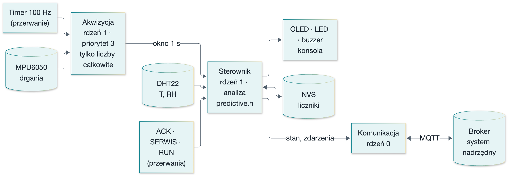
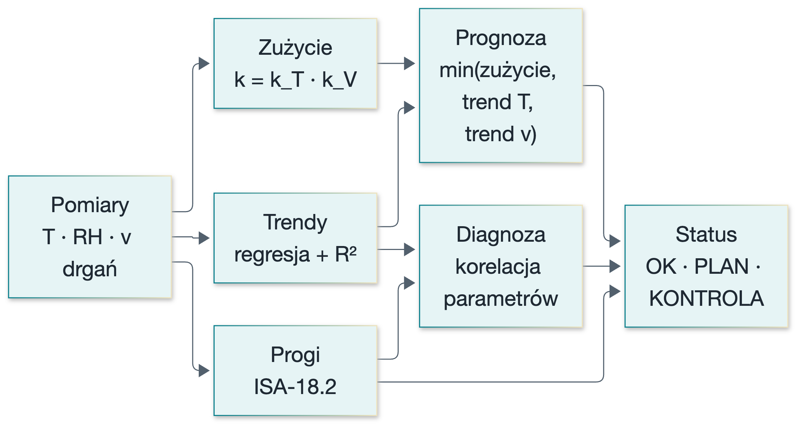
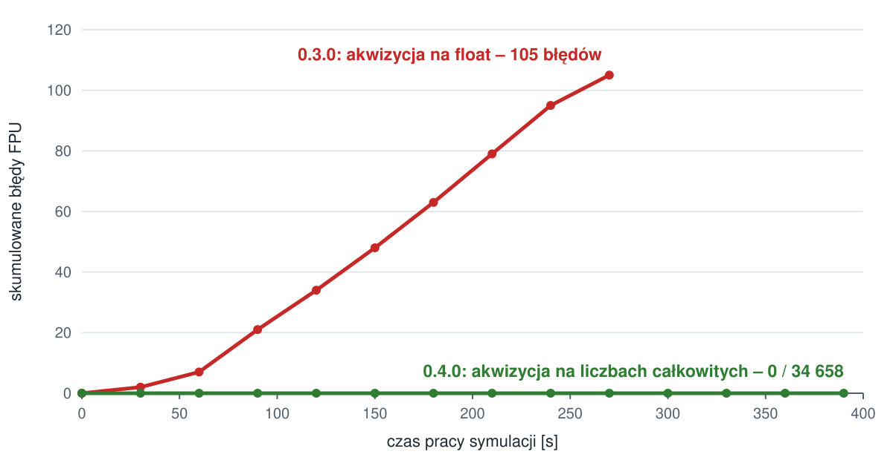
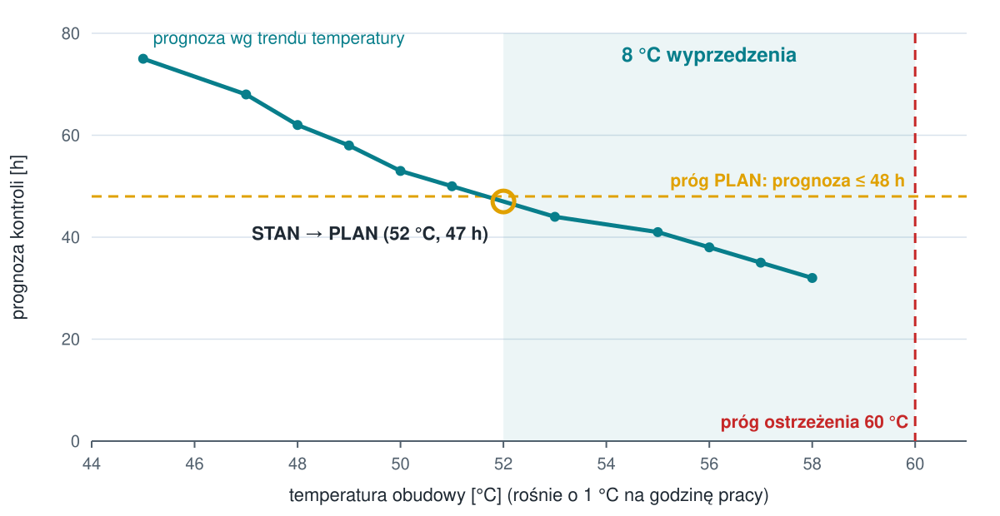

<!-- _class: tytul -->
<!-- _paginate: false -->
<!-- _footer: "" -->

# Inteligentny system utrzymania ruchu maszyn

## Prognoza terminu kontroli · ESP32 · FreeRTOS · MQTT · Wokwi

Wyzwania Technologiczne Przemysłu 4.0 – projekt zaliczeniowy
Autor: [imię i nazwisko]

<!--
0:00–0:20
Pokażę system, który nie tylko alarmuje po przekroczeniu progu, ale przewiduje, kiedy maszyna będzie wymagała kontroli – i podaje dlaczego.
-->

---

# Kiedy serwisować maszynę?

**Reaktywnie**
po awarii

nieplanowany przestój, uszkodzenia wtórne, najwyższy koszt

**Prewencyjnie**
co stały okres (np. 200 h)

serwis za wcześnie (koszt) albo za późno (awaria)

**Predykcyjnie**
gdy wskazuje na to **stan maszyny**

wymaga pomiarów, analizy i komunikacji – Przemysł 4.0

 

**Cel projektu:** mierzyć kilka parametrów pracy, łączyć je w ocenę stanu i **prognozować, za ile
godzin pracy maszyna powinna zostać poddana kontroli** – lokalnie i zdalnie (MQTT).

<!--
0:20–0:45
Przestój nieplanowany jest najdroższy; serwis „co 200 h” bywa za wcześnie albo za późno. Przemysł 4.0 to pomiar + analiza + komunikacja – i to realizuje ten projekt.
-->

---

# Założenia i realizacja wymagań

| Ocena | Wymaganie | Realizacja |
|:---:|---|---|
| 3.0 | jeden parametr | drgania – akcelerometr MPU6050, 100 Hz |
| 3.5 | dwa parametry | + temperatura, wilgotność (DHT22), czas pracy, liczba uruchomień |
| 4.0 | progi alarmowe | ostrzeżenie / alarm, histereza, zwłoka, kwitowanie wg ISA-18.2 |
| 4.5 | historia i zdarzenia | historia 10 min, dziennik zdarzeń, liczniki w pamięci nieulotnej, MQTT |
| **5.0** | **analiza wieloparametrowa + predykcja** | **model zużycia, trendy, diagnoza przyczyny, „kontrola za X h”** |

Maszyna: pompa 2950 obr/min, klasa II wg ISO 10816. Czas przyspieszony: **1 s symulacji = 1 h pracy** –
cykl zużycia widać w kilka minut.

<!--
0:45–1:30
Tabela pokazuje, że projekt pokrywa wszystkie progi. Przyspieszony czas: to, co w zakładzie trwa tygodnie, pokażę w trzy minuty – we wdrożeniu wystarczy zmienić jedną stałą.
-->

---

# Sprzęt (symulator Wokwi)

- **ESP32** – 2 rdzenie, Wi-Fi
- **MPU6050** – drgania, I2C0
- **DHT22** – temperatura, wilgotność
- **OLED** – osobna magistrala I2C1
- **kolumna LED**: OK · PLAN · alarm
- **buzzer**, przyciski **ACK** i **SERWIS**, przełącznik **RUN**

Osobna magistrala dla wyświetlacza – odświeżanie ekranu nie zakłóca pomiaru drgań.

<!--
1:30–2:10
Na schemacie: w środku ESP32, u góry wyświetlacz i akcelerometr na dwóch osobnych magistralach, po lewej kolumna sygnalizacyjna, po prawej przyciski operatora, przełącznik pracy maszyny i czujnik temperatury.
-->

---

# Oprogramowanie: przerwania + FreeRTOS

- przerwania tylko zapisują czas i **budzą zadanie** – zero `delay()` w pętli pracy
- pomiar ma najwyższy priorytet; sieć działa na **drugim rdzeniu**
- pamięć statyczna; algorytm w `predictive.h` – **testowany na komputerze (84 asercje)**

<!--
2:10–3:00
Timer 100 Hz budzi zadanie akwizycji, które co sekundę oddaje sumy okna drgań sterownikowi. Sterownik liczy analizę i obsługuje operatora, a komunikacja MQTT ma własny rdzeń – zawieszona sieć nie zatrzymuje pomiarów.
-->

---

# Algorytm (1): zużycie, trendy, prognoza

**Zużycie** (reguła Palmgrena–Minera):

$$k = \underbrace{2^{\,(T-40)/10}}_{\text{reguła 10 °C}} \cdot \underbrace{\left(\tfrac{v}{2{,}8\ \mathrm{mm/s}}\right)^{3}}_{\text{łożyska L10}}$$

każda godzina pracy zużywa **k** godzin z interwału 200 h

**Trendy:** regresja w oknie 60 h, aktualizacja O(1), liczone tylko przy **R² ≥ 0,6**

**Prognoza terminu kontroli:**

$$t = \min\left(t_{\text{zużycie}},\ t_{\text{trend }T},\ t_{\text{trend }v}\right)$$

+ czynnik, który ją wyznaczył:
`zuzycie` · `trend temp.` · `trend drgan`

Model fizyczny zamiast uczenia maszynowego: działa od pierwszej godziny, nie wymaga historii awarii, każdy wynik da się wyjaśnić.

<!--
3:00–3:45
Każde 10 °C powyżej 40 podwaja tempo starzenia smaru i izolacji; drgania ponad granicę strefy B przyspieszają zużycie łożysk z trzecią potęgą. Trend uznajemy tylko wtedy, gdy jest wiarygodny – szum nie generuje fałszywych prognoz.
-->

---

# Algorytm (2): diagnoza i status

| Objawy | Przyczyna |
|---|---|
| drgania + rosnąca temperatura | **łożysko / smarowanie** |
| tylko temperatura | przegrzewanie |
| tylko drgania | niewyważenie / luz |
| wilgotność ≥ 80 % | wilgoć / korozja |

| Status | Kiedy (wystarczy jeden warunek) |
|---|---|
| KONTROLA | alarm, zużycie ≥ 100 %, prognoza ≤ 8 h |
| PLAN | ostrzeżenie, zużycie ≥ 80 %, prognoza ≤ 48 h |
| OK | brak zastrzeżeń |

Podwyższenie statusu po 2 krokach, obniżenie po 5 – bez alarmów ulotnych i „migotania”.

<!--
3:45–4:30
Te same drgania mogą znaczyć co innego: z rosnącą temperaturą to typowy objaw łożyska, przy stałej temperaturze raczej niewyważenie. Alarmy obsługuję wg ISA-18.2 – z kwitowaniem, histerezą i zwłoką, żeby nie było powodzi alarmów. Za chwilę to pokażę na żywo.
-->

---

# Demonstracja na żywo (3 min)

| Czas | Akcja w Wokwi | Co widać |
|:---:|---|---|
| 0:00 | przełącznik **RUN** → praca | zielona lampka, „kontrola za ~200 h” |
| 0:20 | drgania **+0,10 g** | strefa C, ostrzeżenie, przyczyna: niewyważenie |
| 0:50 | **temperatura rośnie** 40 → 56 °C | przyczyna: **łożysko**, zużycie ×3–4, prognoza maleje |
| ~1:35 | (samo) | KONTROLA **bez przekroczenia progów** – predykcja |
| 2:00 | temperatura **71 °C** | alarm temperatury – przekroczony próg |
| 2:20 | przycisk **ACK**, dziennik zdarzeń | 2 alarmy potwierdzone; te same zdarzenia idą przez MQTT |
| 2:38 | **SERWIS** (3 s) | zużycie 0 %, od razu OK |

Skrypt reżysera `demo/rezyser_demo.js` prowadzi te kroki automatycznie z podpisami · plan B: nagranie.

<!--
4:30–7:30 – przełączam na kartę Wokwi. Skrypt reżysera (demo/rezyser_demo.js) może prowadzić demonstrację automatycznie z podpisami; w razie problemów z siecią sali – nagranie.
-->

---

# Trudności: fałszywy alarm, którego „nie mogło być”

**Objaw:** „kontrola za 1 h (trend drgań)” przy **zatrzymanej** maszynie i pustym oknie trendu

**Diagnoza:** wykluczone hipotezy → szkic testowy z próbą kontrolną → **Wokwi nie zachowuje rejestrów FPU** przy przełączaniu zadań na tym samym rdzeniu (11 475 / 11 475 błędnych obliczeń)

**Rozwiązanie:** akwizycja tylko na liczbach całkowitych, `float` wyłącznie w sterowniku + monitor integralności FPU

Inne: DHT22 milczy na GPIO4 → GPIO16 · drgania styków 40–100 przerwań → filtr 30 ms · `word` to makro Arduino · spóźniony LWT → odświeżanie „online”.

<!--
7:30–8:45
To najciekawsza część pracy inżynierskiej: objaw niemożliwy według logiki. Wykluczyłem dostęp z innych zadań i liczby zmiennoprzecinkowe w przerwaniach, postawiłem hipotezę o przełączaniu kontekstu FPU, potwierdziłem ją izolowanym testem z próbą kontrolną, a poprawkę zmierzyłem w docelowym programie: 105 błędów w 270 s przed, zero po. Na prawdziwym ESP32 to rozwiązanie też pomaga – zadanie 100 Hz nie przełącza kontekstu FPU.
-->

---

# Wynik kluczowy: kontrola wskazana **przed** progiem

Scenariusz T4: temperatura rośnie 1 °C/h. Status PLAN przy **52 °C** – 8 °C przed progiem ostrzeżenia, bez żadnego alarmu parametru.

<!--
8:45–9:10
To różnica między zwykłym progiem a predykcją: system wskazał potrzebę przeglądu, zanim cokolwiek przekroczyło próg, i podał przyczynę – trend temperatury.
-->

---

# Testy i wyniki

| | Scenariusz | |
|:---:|---|:---:|
| T1 | praca, licznik motogodzin | ✅ |
| T2 | progi temperatury, ACK | ✅ |
| T3 | drgania, strefy ISO | ✅ |
| T4 | predykcja z trendu | ✅ |
| T5 | diagnoza: łożysko | ✅ |
| T6 | przegląd i serwis | ✅ |
| T7 | usterka czujnika | ✅ |
| T8 | historia, restart, NVS | ✅ |

8 / 8 scenariuszy

**84** asercje testów jednostkowych

**0** błędów FPU w 34 658 kontrolach

**198 KB** wolnej sterty

**1** pominięty takt na 38 800 próbek

<!--
9:10–9:35
Scenariusze obejmują przypadki standardowe, brzegowe – restart, skok w środku okna pomiarowego – i awaryjne, jak odłączony czujnik. Wszystkie wyniki są w TESTY.md z fragmentami dzienników.
-->

---

# Dalszy rozwój

**Analiza**
- FFT i analiza obwiedni – częstotliwości łożyskowe
- uczenie linii bazowej i wykrywanie anomalii (flota maszyn)
- prąd silnika, ciśnienie, przepływ

**Integracja i bezpieczeństwo**
- panel Grafana / Node-RED, baza szeregów czasowych
- CMMS: automatyczne zlecenie przeglądu
- MQTT przez TLS, uwierzytelnienie, aktualizacje OTA

<!--
9:35–9:50
Najbliższy krok to prawdziwy czujnik drgań z analizą widma – wtedy diagnoza łożyska opiera się na częstotliwościach charakterystycznych, a nie tylko na korelacji z temperaturą.
-->

---

<!-- _class: tytul -->
<!-- _paginate: false -->
<!-- _footer: "" -->

# Podsumowanie

## System mierzy · łączy parametry · przewiduje termin kontroli · wskazuje przyczynę

Kod, dokumentacja, testy: repozytorium projektu (README → DOKUMENTACJA → TESTY)

**Dziękuję – pytania?**

<!--
9:50–10:00
System mierzy, łączy parametry, przewiduje termin kontroli i mówi, co jest prawdopodobną przyczyną – a cała logika jest przetestowana i udokumentowana. Dziękuję.
-->

---

<!-- _class: sekcja -->
<!-- _footer: "" -->

# Materiały zapasowe

---

# Pytania – krótkie odpowiedzi

| Pytanie | Odpowiedź |
|---|---|
| Dlaczego nie uczenie maszynowe? | brak historii awarii do uczenia; model fizyczny działa od razu i jest wyjaśnialny |
| Skąd prędkość z akcelerometru? | v = a / (2π f) dla składowej 1× obroty (49,2 Hz); docelowo FFT |
| Po co przyspieszony czas? | demonstracja w minutach; we wdrożeniu `kTimeScale = 1` |
| Brak sieci? | pomiary, analiza i sygnalizacja lokalnie; MQTT wraca z odstępem wykładniczym |
| Fałszywe alarmy? | zwłoka, histereza, potwierdzanie statusu, R² trendów, monitor FPU |
| Błąd FPU na sprzęcie? | ESP-IDF zapisuje rejestry FPU; problem dotyczy symulatora – rozwiązanie i tak oszczędza przełączeń |
| Bezpieczeństwo MQTT? | publiczny broker tylko do demonstracji; docelowo TLS, uwierzytelnienie, ACL |

<!-- Slajd zapasowy – do pytań. -->

---

# Zadania i przerwania (szczegóły)

| Kontekst | Rdzeń | Priorytet | Zakres | FPU |
|---|:---:|:---:|---|:---:|
| ISR timera 100 Hz | 1 | – | powiadomienie akwizycji | nie |
| ISR GPIO (ACK, SERWIS, RUN) | 1 | – | znacznik czasu, powiadomienie | nie |
| akwizycja | 1 | 3 | MPU6050, sumy okna (Q8, `uint64`) | **nie** |
| sterownik `loop()` | 1 | 1 | DHT22, analiza, HMI, NVS, konsola | tak |
| komunikacja | 0 | 1 | Wi-Fi, MQTT, LWT | tak |

Komunikacja między zadaniami: powiadomienia, skrzynki (najnowszy stan), kolejka zdarzeń FIFO, kolejka poleceń. Stan maszyny ma jednego właściciela – brak muteksów.

<!-- Slajd zapasowy – do pytań o architekturę. -->
